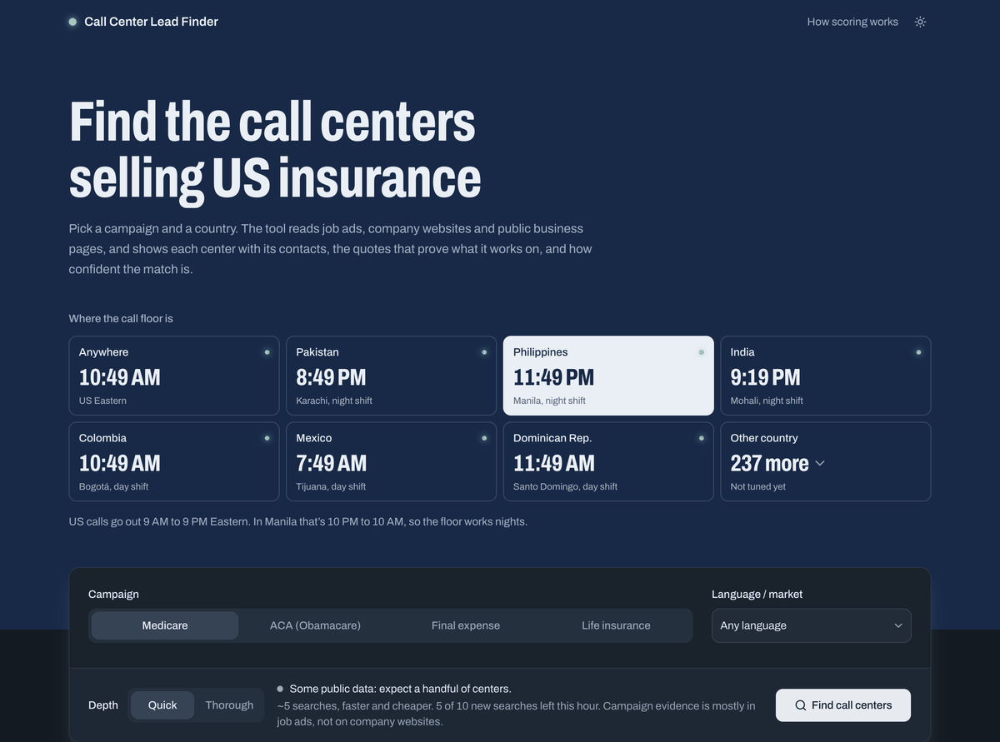

# BPO Lead Finder

An evidence-backed search tool for finding offshore and nearshore call centers that work on US insurance campaigns. Pick a country and a campaign, then review ranked leads with source quotes, public business contacts, and a breakdown of how each result scored.

[Open the live demo](https://bpo-lead-finder.vercel.app) · [Run locally](#run-locally)



Try **Pakistan → Final expense → Quick** to follow the walkthrough with sample search results.

## Run locally

Use Node.js 24 and the pnpm version pinned in `package.json`.

```bash
git clone https://github.com/vigani1/bpo-lead-finder.git
cd bpo-lead-finder
pnpm install
cp .env.example .env.local
SEARCH_PROVIDER=fixture pnpm dev
```

Open [localhost:3000](http://localhost:3000). Fixture mode uses bundled search hits without a search API key. The app can still read the linked company websites, so counts may change. PGlite runs PostgreSQL locally and applies migrations on first use.

## What the AI does

The optional LLM classifier reads extracted website text and search snippets. It identifies the organization and its role, looks for location and language signals, and proposes which campaigns the company works on. It returns structured claims with supporting quotes.

Application code validates the response schema, checks that each quote appears in the source, and applies rules that test whether the quote supports the claim. For example, a job listing asking for final-expense *experience* is weak evidence that the employer runs a final-expense campaign. Separate code merges company records and computes confidence from the accepted evidence. The lead page shows both the quotes and the score breakdown so a reviewer can trace the result.

Model calls are cached by document hash, classifier, and prompt version. A keyword classifier runs when no model is configured, when a model call fails, or when a source disallows AI input. See the [classifier design](docs/adr/0005-ai-extracts-code-decides.md) and [scoring rules](docs/rules.md).

## How it works

1. **Discover.** Build country- and campaign-specific queries for company sites, hiring ads, and public business pages. Tavily supplies search results and optional Exa discovery adds company websites.
2. **Read.** Fetch allowed company pages and use search snippets for sources such as job boards. Strip personal contact details from job and social snippets before classification.
3. **Verify and rank.** Check extracted claims, merge duplicates, and rank companies by evidence strength, recency, and fit. Review the evidence, filter the table, or export it to CSV.

Built with Next.js, React, TanStack Query and Table, Tailwind CSS, Drizzle, and PostgreSQL. Searches run in the background and the results page polls for progress.

## Configuration

| Setting | Purpose |
| --- | --- |
| `SEARCH_PROVIDER=fixture` | Replay bundled search hits for a local walkthrough. |
| `SEARCH_PROVIDER=tavily` | Run live discovery. `TAVILY_API_KEY` enables keyed search and JavaScript page extraction. |
| `EXA_API_KEY` | Add a second search index for company website discovery in live mode. |
| `AI_BASE_URL`, `AI_API_KEY`, `AI_MODEL` | Enable the classifier through an OpenAI-compatible API. Set `AI_JSON_MODE=object` for providers that support JSON objects but lack strict schema mode. |
| `DATABASE_URL`, `DATABASE_URL_UNPOOLED` | Use hosted PostgreSQL. Set the pooled URL for runtime and the direct URL for `pnpm db:migrate`. The Vercel build script applies migrations before building. |

See [.env.example](.env.example) for the full list. A hosted instance shares recent searches and feedback across visitors. Use a dedicated database and account for search and model usage when hosting publicly.

## Evaluation and development

```bash
pnpm lint
pnpm typecheck
pnpm check:rules
pnpm eval:scores
```

The score evaluation replays 48 hand-labelled results. On this snapshot, 21 of 22 High-confidence leads were full matches. The snapshot includes examples used to tune scoring, so treat that figure as a sanity check. Coverage varies by country, campaign, and what companies publish.

The implementation was AI-assisted and manually reviewed. The [architecture decisions](docs/adr), [source research](docs/sources.md), and [roadmap](ROADMAP.md) document the trade-offs and known limits.

## License

The project code is available under the [MIT License](LICENSE). Linked sources and third-party excerpts remain subject to their respective terms.
